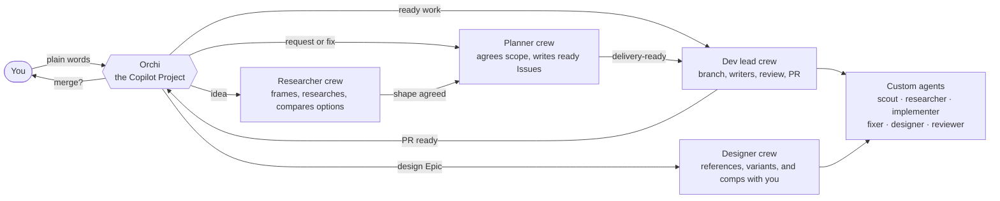

<div align="center">

# Orchi for the GitHub Copilot app

### Say what you want. Get a reviewed, tested, documented PR.

Orchi turns a Copilot Project into a development team.<br>
You talk to the Project in plain words. Child sessions research, plan, design, and build the work,<br>
and only the decisions that are yours come back to you.

**No controller. No database. Git holds the code and docs; GitHub Issues hold the plan.**

[Quick start](#quick-start) · [What it looks like](#what-it-looks-like) · [How it works](#how-it-works) · [What stays yours](#what-stays-yours) · [The gates](#the-gates) · [Under the hood](#under-the-hood) · [Docs](#documentation)

</div>

---

Orchi is a plugin for the [GitHub Copilot app](https://docs.github.com/en/copilot/how-tos/github-copilot-app).
It ports [nkhus/orchi](https://github.com/nkhus/orchi), the Claude Code edition
of the same workflow, to the app's own primitives: a Copilot Project is Orchi,
it routes each request to a child session for its role, and GitHub Issues and
Git branches are the state they share.

## Quick start

**1. Add the marketplace.** In the Copilot app, click **Customize** in the
sidebar, select the marketplace settings control next to the marketplace
dropdown, and add the GitHub repository `nkhus/orchi-copilot`. With the Copilot
CLI:

```bash
copilot plugin marketplace add nkhus/orchi-copilot
```

**2. Install the plugin `orchi`.** On **Customize**, search Browse for `orchi`
and click **Install**. With the Copilot CLI:

```bash
copilot plugin install orchi@orchi-copilot
```

**3. Create a Copilot Project for your repository.** In the sidebar, click
**+** next to Projects and choose the repository.

**4. Type `/orchi`** in the Project's conversation, with your first request if
you have one. From then on that conversation is Orchi; just talk to it. On
its first turn it prepares the repository: labels, Issue forms, the PR
template, the documentation and standards checks, an `AGENTS.md` section, and
the repository's Copilot settings, committed and pushed to the default branch.
You don't commit or push anything. From then on, tell Orchi what you want; it
starts a crew session for each request and archives it when the work is done.

> **Needs** Git, a GitHub remote, an authenticated GitHub CLI (`gh`), and
> Python 3. Orchi does not bundle the design skills
> [Hallmark](https://github.com/Nutlope/hallmark) and Emil Kowalski's
> [prototype](https://github.com/emilkowalski/skills): before the first design
> round it offers to install them with `gh skill`. The plugin's canvases, the
> Orchi board and the design board, open beside the conversation.

The [installation guide](docs/installation.md) covers updating and removing the
plugin, the repository defaults, and everything setup writes.

## What it looks like

An illustrative run. You type in Orchi's conversation, or in a crew's session
when it asks you something there:

```text
you      add CSV export to the orders page
orchi    A planner has it: [planner] csv-export.

planner  Large orders take a while. Stream the file, or email a download link?
         I recommend streaming: no mail setup, and it works offline.
you      stream it
planner  Planned: one Epic, three Tasks. Orchi takes it from here.

orchi    A dev lead is building it: [dev-lead] csv-export.
         ... each new test fails first, then passes · every check green · one full review ...
orchi    PR #112 is ready. Merge risk: two-way door, orders page only. Exceptions: none.
         Merge it?
you      yes
orchi    Merged. One lesson proposed, about a missing fixture. Accept it?
```

You never write a spec, a ticket, a branch name, or a line of code.

## How it works



**Orchi routes; it never does the work itself.** Each request gets its own
crew, a child session of the Project in its own worktree, named after its role
and topic (for example `[planner] csv-export`). The Project lists its crews by
state, and a crew's questions show in Orchi's conversation. A dev lead or
designer crew gives every change to a writer subagent, or to a worker session
of its own for parallel Tasks and long runs, and reviews the result. Agent Merge
keeps a ready PR moving, and Orchi merges it on your yes. When the work is done,
Orchi archives the crew.

**Work moves forward on its own.** A researcher who finishes shaping an idea
continues as its planner, and a planner continues with the first ready item it
planned. A dev lead that finds work outside its scope files it, and Orchi gives
it to a planner.

**The ceremony scales with the work:**

| Scope | Branches | Reaches `main` as |
| --- | --- | --- |
| **Task**, a fix or small change | `fix/<slug>` | one PR |
| **Epic**, a feature | `epic/<tag>-<slug>`, with `task/*` branches for Tasks that run in parallel | one PR |
| **Initiative**, a large outcome | `initiative/<tag>-<slug>`, with one Epic PR into it per Epic | one final PR |

Titles carry their lineage: Initiative `[PAY] Card payments` → Epic
`[PAY][TOKEN] Tokenize stored cards` → Task `[PAY][TOKEN] Add token column`.

## What stays yours

You work on the concept, the vision, and the design; Orchi decides everything
technical and asks you only what it changes for you.

| Always yours | Orchi and its crews handle |
| --- | --- |
| What to build, the scope, and the order you see results in (with autonomous mode off) | Code, tests, branches, Issues, labels, PRs, and how work splits into them |
| The direction of an exploration (with autonomous mode off) | Research, options, and recommendations |
| Design references, every direction, comp, and generated asset (with autonomous mode off) | Variants to choose from, and building against what you approved |
| Product constraints | The stack, tools, thresholds, exceptions, and CI |
| A yes to each merge into `main`, unless you turn on autonomous mode | Review, repairs, rechecks, and the merge itself |
| Deploys, access, money, and destructive actions | Keeping the documentation current, and every Git and GitHub step |

**Autonomous mode** starts off: crews ask you in their own sessions. Tell Orchi
to turn it on, and crews ask only Orchi, which decides from each crew's
recommendation, records each decision, lists them for you, and merges a PR into
`main` once its checks pass, its review leaves nothing unresolved, and its main
outcome is proven. Money, access, deploys, destructive actions, and removing
what users have today still wait for you.

## The gates

Orchi assumes agents write all the code and nobody reads it. Tools and one
rigorous review are the gate.

- **Agree before anything is tracked.** Research, a proposed scope, and the
  breakdown come first. Issues and branches follow your agreement.
- **Tests first.** Every new test is shown failing before the change, and every
  acceptance criterion gets an acceptance test.
- **Standards enforced by CI.** `ENGINEERING.md` declares each check as a
  blocking CI job; the core checks come with the first code, and a project meant
  to last adds coverage, accessibility (WCAG 2.2 AA), security, and license
  checks. An existing project gets an audit and one standards Epic.
- **No quiet loopholes.** A suppression, a loosened config, a skipped test, or a
  CI step that no longer fails needs a recorded exception, and each exception
  reaches you in plain words.
- **One full review, precise repairs.** Each result is reviewed for spec, scope,
  standards, and tests, plus a design audit when the UI changes. Only
  demonstrated defects are repaired, and repairs are rechecked once.
- **Every PR explains itself.** Evidence for each criterion, every finding and
  its resolution, a merge risk, its exceptions, and its documentation impact.
- **Docs that never go stale.** `main` holds only how the product works now;
  plans live in `docs/work/` on the work's branch until they settle.
- **It learns.** Each delivery proposes at most three lessons, each turned into
  a check, a form field, a coding standard, or a pointer once you accept it.

## Under the hood

Orchi is a Copilot plugin of skills and custom agents. Git and GitHub are its
only shared state: claims, labels, native sub-issues, `blocked by`
dependencies, and PRs. Any session can restart and catch up.

<details>
<summary><strong>Skills</strong>: you type only <code>/orchi</code>; the rest are hidden role skills</summary>

| Skill | Run by | Does |
| --- | --- | --- |
| [`orchi`](plugins/orchi/skills/orchi/SKILL.md) | You (the Project, or `/orchi [request]`) | Makes the conversation Orchi: prepares the repository, starts a crew per request, relays what crews report, and tells you only about decisions, merges, and waiting questions |
| [`orchi-explore`](plugins/orchi/skills/orchi-explore/SKILL.md) | Researcher crew | Shapes an idea with you in an `Exploration` Issue and an `explore/<slug>` branch, then continues into planning |
| [`orchi-plan`](plugins/orchi/skills/orchi-plan/SKILL.md) | Planner crew | Proposes a scope, clarifies, shows the breakdown, creates ready Issues, and labels them `delivery-ready` |
| [`orchi-standards`](plugins/orchi/skills/orchi-standards/SKILL.md) | Planner crew | Audits an existing project's checks and plans a standards Epic, or plans hardening |
| [`orchi-design`](plugins/orchi/skills/orchi-design/SKILL.md) | Designer crew | Runs a `design` Epic with you: references, engine and direction rounds, an approved comp per surface, and the builds |
| [`orchi-deliver`](plugins/orchi/skills/orchi-deliver/SKILL.md) | Dev lead crew | Delivers a Task, Epic, or Initiative through writer subagents, one review, and a PR; never merges into `main` itself |
| [`orchi-work`](plugins/orchi/skills/orchi-work/SKILL.md) | A worker session, started by a crew for one task | Implements, fixes, or designs one Task, runs long checks, merges a conflicting base, or answers one research question |
| [`orchi-core`](plugins/orchi/skills/orchi-core/SKILL.md) | Every Orchi session | The workflow: scope, readiness, execution, testing, review, knowledge, standards, and the pool |

</details>

<details>
<summary><strong>Custom agents</strong>: six roles, each with a pinned model</summary>

| Agent | Model | Writes | Role |
| --- | --- | --- | --- |
| `orchi-scout` | `claude-haiku-5.5` | nothing | Returns paths, line ranges, and excerpts |
| `orchi-researcher` | `claude-opus-5.5` | nothing | Answers a question from cited primary sources, or designs one option |
| `orchi-implementer` | `claude-opus-5.5` | one commit per run | Runs the Task readiness gate, then implements and verifies one Task |
| `orchi-fixer` | `claude-sonnet-5.5` | one commit per run | Makes one small, fully specified change or a confirmed repair |
| `orchi-reviewer` | `claude-opus-5.5` | nothing | Reviews a Task, an assembled Epic, or a final Initiative candidate |
| `orchi-designer` | `claude-opus-5.5` | one commit per UI Task; variant files when building variants; nothing when auditing | Builds variants for a design round, builds one UI Task, or audits a UI diff |

Sessions start them with the `task` tool. Subagents never talk to you, change
Issues, push, or merge. See [roles](plugins/orchi/skills/orchi-core/references/roles.md).

</details>

<details>
<summary><strong>What setup adds to your repository</strong></summary>

| File or directory | Purpose |
| --- | --- |
| `AGENTS.md` | A managed section that sends work to Orchi |
| `.github/ISSUE_TEMPLATE/orchi-*.yml` | The Initiative, Epic, Task, and Exploration forms |
| PR template | A managed section: Summary, Verification, Merge risk, Exceptions, Documentation impact, and Handoff |
| `.github/workflows/orchi-docs.yml`, `orchi-standards.yml` | The documentation and standards checks |
| `.github/orchi/scripts/` | Copies of `knowledge.py` and `standards.py` that the workflows run |
| `.github/orchi/manifest.json` | The digests of what setup manages |
| `.github/copilot/settings.json` | Offers the plugin to everyone who works on the repository |
| `.github/github-app.yml` | When missing: instructions for the app's sessions |
| `.gitignore` | A managed section that ignores `.orchi-tmp/` |
| Labels | The nine labels the workflow uses |

Setup keeps your own content: it maintains only the sections between
`<!-- orchi:begin -->` and `<!-- orchi:end -->` and the files it created, and
refuses to overwrite anything you edited. Your repository's instructions take
precedence over Orchi's defaults.

</details>

## Documentation

| Guide | Read it to… |
| --- | --- |
| [Documentation map](docs/README.md) | Find the page for each part of Orchi and the decisions in force |
| [Workflow](docs/workflow.md) | Follow exploration, planning, delivery, and review |
| [Pool](docs/pool.md) | See how Orchi and its crews work in a Copilot Project |
| [Design](docs/design.md) | See how UI work runs |
| [Canvases](docs/canvases.md) | See the Orchi board and the design board |
| [Standards](docs/standards.md) | See `ENGINEERING.md`, the default stack and checks, and gate integrity |
| [Context](docs/context.md) | See how documentation stays current |
| [Installation](docs/installation.md) | Install, update, or remove Orchi, and see what setup writes |
| [Testing](docs/testing.md) | Validate the package and check live behavior |
| [Upstream](docs/upstream.md) | See what was ported from the Claude Code edition |

The [core skill](plugins/orchi/skills/orchi-core/SKILL.md) is the complete
workflow; its [references](plugins/orchi/skills/orchi-core/references/) cover
each stage.

## Contributing

The plugin lives in `plugins/orchi/`: skills in `skills/` and custom agents in
`agents/`. Validation, tests, and repository documentation live in `tools/`,
`tests/`, and `docs/`.

```bash
python3 -m venv .venv && . .venv/bin/activate
python -m pip install -r requirements-dev.txt
python tools/validate_package.py
python -m pytest -q
```

See [`AGENTS.md`](AGENTS.md) for the rules. Deterministic tests establish
script and text behavior, not live model behavior.
